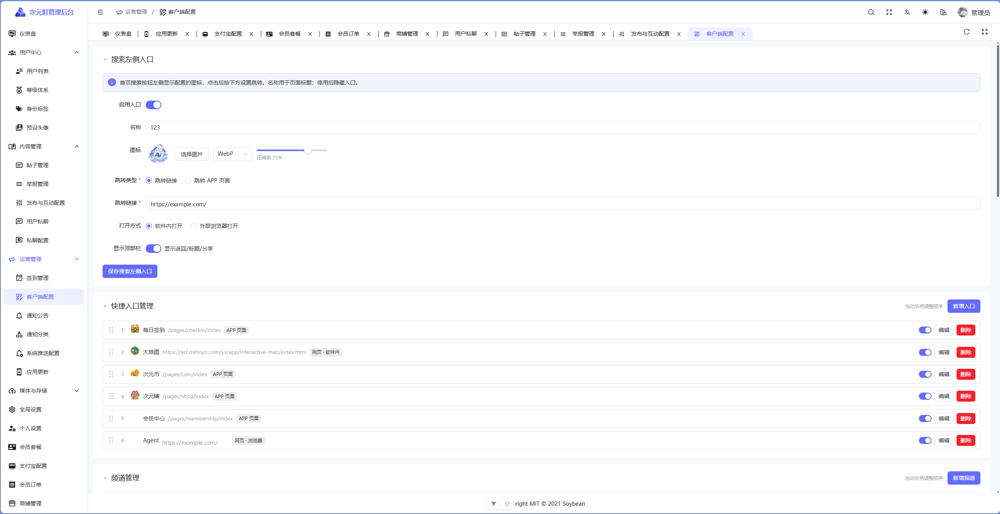

# 次元町 · ciyuantown

一个二次元社区 App 的全栈开源实现：**uni-app x 客户端** + **Spring Boot 后端** + **Vue3 管理后台**。

三端代码、数据库结构、设计文档全部开源，用于学习与二次开发。

<p align="center">
  
  <br>
  <sub>图 1 · 客户端：私信会话 / 首页频道 / 个人主页 / 发现页</sub>
</p>

<p align="center">
  
  <br>
  <sub>图 2 · 管理后台：用户档案 · 快捷入口管理</sub>
</p>

> 本项目按「可运行的最小完整形态」整理：所有密钥、账号、服务器地址均已替换为占位符，需要你自己配置后才能跑起来。详见 [配置](#配置)。

---

## 功能概览

| 模块 | 内容 |
| --- | --- |
| 社区 | 图文/视频动态、双列瀑布流、话题标签、点赞/收藏/评论、关注与粉丝 |
| 私信 | 一对一聊天、会话列表、消息回执、未读计数、管理端审计 |
| 内容运营 | 首页频道、快捷入口配置、公告与推送、举报处理、草稿箱 |
| 会员体系 | 会员套餐与订单、签到与虚拟币、等级配置、头像框 |
| 媒体 | 本地上传 + OSS/七牛/FTP 多存储后端，ffmpeg 视频转码与封面 |
| 账号 | 验证码登录/密码登录、JWT 双 Token、账号注销 |
| 系统 | Redis 缓存与限流（可关闭）、应用版本更新、法律链接配置 |

## 技术栈

- **客户端** `app/`：uni-app x（Vue3 + UTS + UVUE），HBuilderX 编译，覆盖 Android / iOS / H5 / 微信小程序
- **管理后台** `admin/`：基于 [SoybeanAdmin](https://github.com/soybeanjs/soybean-admin)，Vue3 + Vite + TypeScript + Naive UI + UnoCSS
- **后端** `server/`：Spring Boot 3.5 + Java 21 + MyBatis-Plus + MySQL 8 + Redis

## 目录结构

```
cytown/
├── app/            # uni-app x 客户端源码
├── admin/          # 管理后台（Vue3）
├── server/         # Spring Boot 后端
├── sql/            # 数据库结构（仅建表，无数据）
├── docs/           # 模块设计文档
└── README.md
```

## 快速开始

### 1. 数据库

```bash
mysql -u root -p -e "CREATE DATABASE ciyuantown DEFAULT CHARSET utf8mb4 COLLATE utf8mb4_unicode_ci;"
mysql -u root -p ciyuantown < sql/ciyuantown.sql
```

`sql/ciyuantown.sql` 只包含 88 张表的结构，没有任何业务数据，因此**没有默认管理员账号**。
首次使用请自行向 `admin_user` 插入一条记录，密码字段为 BCrypt 哈希：

```sql
INSERT INTO admin_user(username, password, nickname, user_type, status)
VALUES('admin', '$2a$10$替换为BCrypt哈希', '超级管理员', 0, 0);
```

### 2. 后端

```bash
cd server
cp .env.example .env      # 然后按注释填写数据库、Redis、密钥
./mvnw spring-boot:run
```

默认监听 `8080`；`application.yml` 通过 `spring.config.import` 读取同目录 `.env`，环境变量优先级更高。

### 3. 管理后台

```bash
cd admin
pnpm install
pnpm dev     # 默认 http://localhost:9527
```

开发代理指向 `http://localhost:8080`，生产地址在 `.env.prod` 的 `VITE_SERVICE_BASE_URL`。

### 4. 客户端

需要 HBuilderX（uni-app x 版本），或用 CLI：

```bash
cd app
npm ci --ignore-scripts
npm run dev:h5 -- --port 15273 --host 127.0.0.1
npm run dev:app         # Android 真机/模拟器
npm run dev:mp-weixin   # 微信小程序
```

`npm run connect:usb` 会建立 `adb reverse` 隧道，让手机通过 USB 访问本机后端。
构建、签名与调试细节见 [app/docs/uniapp-x-build-and-usb.md](app/docs/uniapp-x-build-and-usb.md)。

## 配置

| 配置文件 | 用途 | 是否入库 |
| --- | --- | --- |
| `server/.env` | 数据库、Redis、JWT 密钥、SMTP、存储密钥 | 否，由 `.env.example` 复制 |
| `app/.env.development` / `.env.production` | 客户端 API 地址 | 是（无密钥） |
| `app/.env.local` | IP 定位接口 key | 否 |
| `admin/.env` / `.env.prod` | 管理后台构建配置与服务地址 | 是（无密钥） |

需要自己生成的关键变量：

- `JWT_SECRET`：HS256 签名密钥，建议 64 位以上随机串
- `CHAT_MEDIA_KEY` / `MEDIA_CONFIG_KEY` / `MEMBERSHIP_CONFIG_KEY`：AES 加密密钥
- `DB_PASSWORD`、`SMTP_*`：数据库与邮件服务凭据
- `IP_LOCATE_KEY`：IP 归属地查询服务的 key（不使用可留空）

## 文档

`docs/` 下按模块记录了设计与实现，例如：

- [私信系统](docs/private-chat.md) · [私信管理端](docs/private-chat-admin.md)
- [等级体系设计](docs/level-system-design.md) · [签到](docs/checkin.md)
- [Redis 架构](docs/redis-architecture-redesign.md)
- [社交互动](docs/social-interactions-20261010.md) · [消息盒子](docs/social-inbox.md)
- [用户注销](docs/user-deletion.md) · [账号管理](docs/user-account-management.md)

## 安全提示

- 仓库内所有密钥均为占位符，**部署前必须全部替换**
- 生产环境请使用 HTTPS，客户端生产构建会强制校验
- 管理后台建议限制来源 IP 或加一层网关鉴权
- 数据库脚本不含任何真实用户数据，可放心公开

## 许可证

本项目采用 [Apache License 2.0](LICENSE)。

在保留版权声明与 [NOTICE](NOTICE) 的前提下，你可以自由使用、修改、商用与再分发；协议同时包含明确的专利授权条款。

`admin/` 目录派生自 [SoybeanAdmin](https://github.com/soybeanjs/soybean-admin)，继续遵循其原始 MIT 协议，版权归原作者所有。
