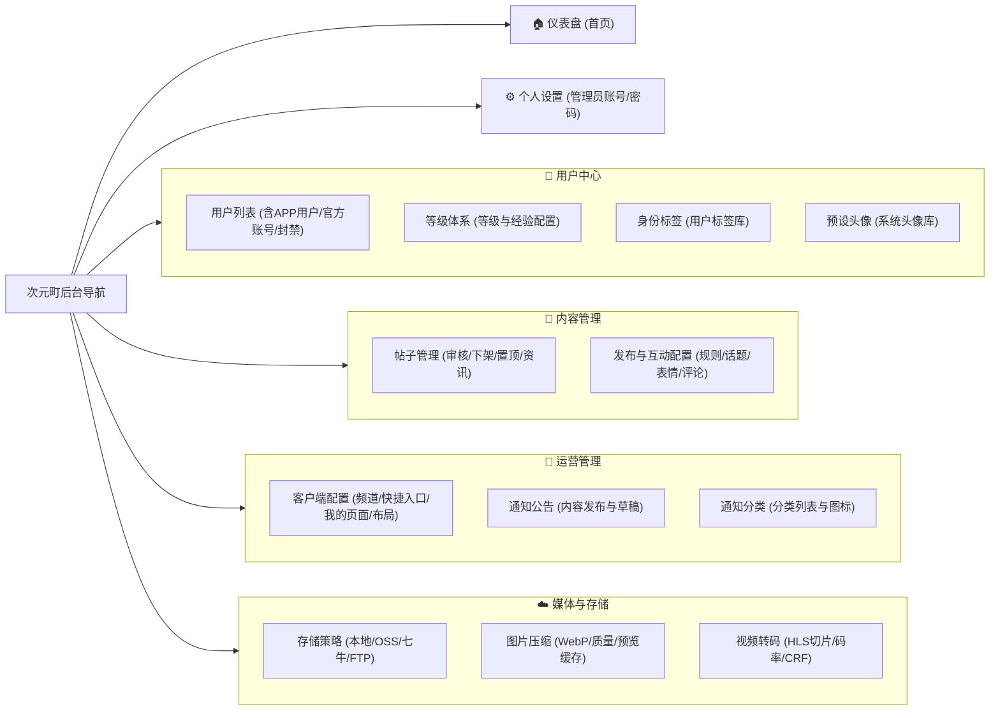

# 次元町管理后台 - 菜单分类与排序重构方案

> **文件说明**：本文档旨在重新梳理并规范次元町管理后台（Admin Dashboard）的父级菜单与子菜单层级、命名及排序逻辑。  
> **状态**：**已实施落地完毕**（代码修改已编译构建通过，生产打包测试无报错）。

---

## 一、 当前现状与痛点分析

经过对当前前端路由配置（`build/plugins/router.ts`、`src/store/modules/route/shared.ts`、`src/locales/langs/zh-cn.ts`）的全面排查，当前后台菜单存在以下结构性问题：

### 1. 痛点问题汇总

1. **父子菜单同名，视觉与认知混淆**：
   - 父级分组叫“用户管理”，子级第一项也是“用户管理”（`app-user-manage`）；
   - 父级分组叫“帖子管理”，子级第一项也是“帖子管理”（`post-manage`）；
   - 在侧边栏折叠/展开时极度冗余，用户无法直观区分“整体模块”与“具体功能页面”。
2. **新上线页面遗漏分组，游离散落**：
   - 新增的 `level-settings`（等级配置）在之前的 `MENU_GROUPS` 中被遗漏，导致系统回退机制将其直接堆在菜单最末端（甚至排在个人中心后面），严重破坏了用户体系的完整性。
3. **单页面强制成组，增加无意义点击**：
   - 原配置中，“运营配置”分组下仅有“首页配置”一个子项；“个人中心”分组下仅有“个人设置”一个子项；
   - 只有一个子项的分组在侧边栏需要先点击展开再点击子项，降低了管理操作效率。
4. **命名与实际业务边界不符**：
   - `home-config`（首页配置）不仅配置首页频道和快捷入口，还包含“我的”页面入口配置、全站帖子默认瀑布流单双列布局，仅叫“首页配置”名不符实；
   - `publish-settings`（发布设置）不仅管发布参数，还深度集成了“话题管理与审核”、“表情包管理”、“字体颜色与分割线样式”，属于社区内容的核心运营。
5. **菜单排序缺乏业务逻辑梯度**：
   - 现有排序整体偏向“开发时间先后”，而非“管理员日常高频操作动线”（如仪表盘概览 -> 用户中心 -> 内容社区 -> 运营配置 -> 媒体基础设施 -> 账号设置）。

---

## 二、 推荐重构方案（方案一：标准专业社区架构）

该方案将当前所有 14 个功能页面划分为 **1 个独立顶层首页 + 4 个业务领域父级菜单 + 1 个独立底层设置**。

### 1. 视觉架构总览 (Mermaid 拓扑)

---

### 2. 方案一详细分类与排序清单

| 菜单层级 | 菜单中文名 | 英文名/路由 Key | 建议图标 (Icon) | 排序值 (Order) | 核心职责说明 |
| :--- | :--- | :--- | :--- | :--- | :--- |
| **一级单项** | **仪表盘** | `home` | `mdi:monitor-dashboard` | 10 | 系统访问量、动态概览、工作台数据统计（直达页面，不折叠） |
| **一级分组** | **用户中心** | `user-center-group` | `mdi:account-group` | 20 | **围绕用户全生命周期的账号、成长与画像管理** |
| ├─ 二级子项 | 用户列表 | `app-user-manage` | `mdi:account-details` | 21 | APP用户查询、状态封禁/解禁、资料编辑、官方账号管理 |
| ├─ 二级子项 | 等级体系 | `level-settings` | `mdi:medal-outline` | 22 | 用户等级配置、升级经验阈值、等级专属特权（**归位用户中心**） |
| ├─ 二级子项 | 身份标签 | `user-tag` | `mdi:tag-multiple` | 23 | 用户认证标签、兴趣标签库的新增与维护 |
| └─ 二级子项 | 预设头像 | `user-avatar` | `mdi:account-box-multiple` | 24 | 系统默认预设头像素材库维护 |
| **一级分组** | **内容管理** | `content-management-group`| `mdi:book-open-page-variant-outline` | 30 | **社区核心 UGC 内容与创作互动生态** |
| ├─ 二级子项 | 帖子管理 | `post-manage` | `mdi:card-text-outline` | 31 | 帖子列表、审核（待审/通过/下架）、首页资讯精选、帖子详情 |
| └─ 二级子项 | 发布与互动配置 | `publish-settings` | `mdi:tune-vertical` | 32 | 发帖字数/媒体限制、评论设置、话题增删审、表情包、排版样式 |
| **一级分组** | **运营管理** | `operation-management-group` | `mdi:bullhorn-outline` | 40 | **面向客户端用户的运营活动、页面展示与信息触达** |
| ├─ 二级子项 | 客户端配置 | `home-config` | `mdi:view-dashboard-edit-outline`| 41 | 首页频道栏、快捷入口、滚动资讯条、我的页面入口、单双列布局 |
| ├─ 二级子项 | 通知公告 | `notice-manage` | `mdi:bell-outline` | 42 | 系统通知与公告的图文混排编辑、关联帖子、发布与下架 |
| └─ 二级子项 | 通知分类 | `notice-category` | `mdi:shape-outline` | 43 | 通知业务分类管理（系统通知、活动公告等）与图标维护 |
| **一级分组** | **媒体与存储** | `media-management-group` | `mdi:cloud-upload-outline` | 50 | **多媒体流媒体处理与云存储基础设施支撑** |
| ├─ 二级子项 | 存储策略 | `storage-config` | `mdi:server-network` | 51 | 本地磁盘、阿里云 OSS、七牛云、FTP 存储节点与凭证 |
| ├─ 二级子项 | 图片压缩 | `image-compression` | `mdi:image-filter-vintage` | 52 | WebP 转换、压缩质量梯度、预览图与客户端图片缓存设置 |
| └─ 二级子项 | 视频转码 | `video-transcode` | `mdi:video-vintage` | 53 | FFmpeg HLS 分段、CRF、1080P/720P/480P 阶梯码率配置 |
| **一级单项** | **个人设置** | `profile` | `mdi:account-cog` | 60 | 管理员个人资料维护、修改密码（作为底部独立项，无需多余折叠） |

---

## 三、 备选紧凑方案（方案二：扁平精简4大组）

如果希望进一步缩减父级菜单数量，可将【内容】与【运营】合流，形成更为精简的 4 大分组体系：

- **🏠 仪表盘** (`home`)
- **👥 用户管理** (`user-management-group`)
  - 用户列表 (`app-user-manage`)
  - 等级配置 (`level-settings`)
  - 用户标签 (`user-tag`)
  - 系统头像 (`user-avatar`)
- **📝 社区与运营** (`community-operation-group`)
  - 帖子管理 (`post-manage`)
  - 发布设置 (`publish-settings`)
  - 客户端配置 (`home-config`)
  - 通知管理 (`notice-manage`)
  - 通知分类 (`notice-category`)
- **☁️ 媒体与存储** (`media-management-group`)
  - 存储配置 (`storage-config`)
  - 图片压缩 (`image-compression`)
  - 视频转码 (`video-transcode`)
- **⚙️ 个人设置** (`profile`)

> **优缺点对比**：
> - **方案一（推荐）**：业务职能清晰明确，内容审核与日常客户端运营分开，后续扩展“Banner运营”、“活动管理”、“评论审核”时有明确落地点，更符合中大型社区后台标准。
> - **方案二**：一级分类更少，但“社区与运营”下拉内有 5 个子项，日常查找稍显杂糅。

---

## 四、 新旧对照总览表（改动差异一目了然）

| 原菜单名称 | 原层级 | 存在的问题 | 方案一优化后名称 | 方案一归属层级 | 改进效果 |
| :--- | :--- | :--- | :--- | :--- | :--- |
| **首页** | 一级单项 | 无大问题 | **仪表盘** (或保留首页) | 一级单项 | 定位清晰，直达数据面板 |
| **用户管理** | 一级折叠（但与子项同名） | 产生“用户管理套用户管理”的歧义 | **用户中心** | 一级分组 | 明确为模块中心 |
| **用户管理** (子项) | 二级子项 | 与父级同名 | **用户列表** | 用户中心 -> 子项 | 突出列表与账号管理职能 |
| **等级配置** | **散落在最末尾** | 遗漏在分组之外，位置错乱 | **等级体系** | **用户中心 -> 子项** | **回到用户模块，排序紧跟用户列表** |
| **用户标签** | 二级子项 | 排序在头像前，合理 | **身份标签** | 用户中心 -> 子项 | 语义更准确 |
| **系统头像** | 二级子项 | 合理 | **预设头像** | 用户中心 -> 子项 | 保持一致 |
| **帖子管理** | 一级折叠（但与子项同名） | 产生“帖子管理套帖子管理”的歧义 | **内容管理** | 一级分组 | 涵盖帖子、话题、发布机制等广义内容 |
| **帖子管理** (子项) | 二级子项 | 与父级同名 | **帖子管理** | 内容管理 -> 子项 | 层级关系变得顺畅 |
| **发布设置** | 二级子项 | 包含话题审核与表情包，名称略窄 | **发布与互动配置** (或发布设置) | 内容管理 -> 子项 | 贴合包含话题/表情包/规则的实际范围 |
| **运营配置** | 一级折叠 | 只有“首页配置”一个子项，冗余折叠 | **运营管理** | 一级分组 | 整合客户端配置与通知公告体系 |
| **首页配置** | 二级子项 | 实际包含了“我的”入口与瀑布流布局 | **客户端配置** | 运营管理 -> 子项 | 准确体现 APP 端页面全局配置 |
| **通知管理** (原分组) | 一级折叠 | 仅有 2 个子项，独立一级略显分散 | **合并入【运营管理】** | — | 精简一级结构，聚合运营动作 |
| **通知内容** | 二级子项 | 叫“内容”不如“公告”明确 | **通知公告** | 运营管理 -> 子项 | 规范通知发布与草稿管理 |
| **通知分类** | 二级子项 | 合理 | **通知分类** | 运营管理 -> 子项 | 紧跟通知公告 |
| **媒体与存储** | 一级折叠 | 结构良好 | **媒体与存储** | 一级分组 | 保持底层运维隔离，定位清晰 |
| **存储配置** | 二级子项 | 合理 | **存储策略** (或存储配置) | 媒体与存储 -> 子项 | 保持一致 |
| **图片压缩** | 二级子项 | 合理 | **图片压缩** | 媒体与存储 -> 子项 | 保持一致 |
| **视频转码** | 二级子项 | 合理 | **视频转码** | 媒体与存储 -> 子项 | 保持一致 |
| **个人中心** (原分组) | 一级折叠 | 只有一个“个人设置”，属于过度折叠 | **个人设置 (变为单项)** | 一级单项 (底部) | 类似常见后台，底部直达个人资料/改密 |

---

## 五、 后续技术实施落地指南（待您确认后执行）

本方案完全兼容当前项目的技术栈（Soybean Admin + `@elegant-router`），**无需迁移页面物理文件目录**，只需修改以下 3 个核心配置即可安全生效：

1. **`src/store/modules/route/shared.ts`**：
   - 优化 `MENU_GROUPS` 结构：
     - 将 `level-settings` 纳入 `user-center-group`（用户中心）；
     - 将 `notice-manage` 与 `notice-category` 合并入 `operation-management-group`（运营管理）；
     - 将 `profile` 从折叠组移除，改为 `MENU_ORDER_LAYOUT` 中的 `single` 顶层项；
   - 更新 `MENU_ORDER_LAYOUT` 的排序序列（仪表盘 -> 用户中心 -> 内容管理 -> 运营管理 -> 媒体与存储 -> 个人设置）。
2. **`src/locales/langs/zh-cn.ts` & `en-us.ts`**：
   - 更新对应子菜单和父级菜单的中英文多语言文案（如 `app-user-manage` 显示为“用户列表”）。
3. **`build/plugins/router.ts`**：
   - 校准各个路由的 `order` 权重和 `icon` 图标，保持路由元信息与实际展示逻辑一致。

---

> 💬 **请审阅以上分类与命名，您可以提出具体的微调意见（如名称喜好、顺序调整或归属合并），确认无误后我将为您快速实施落地！**
